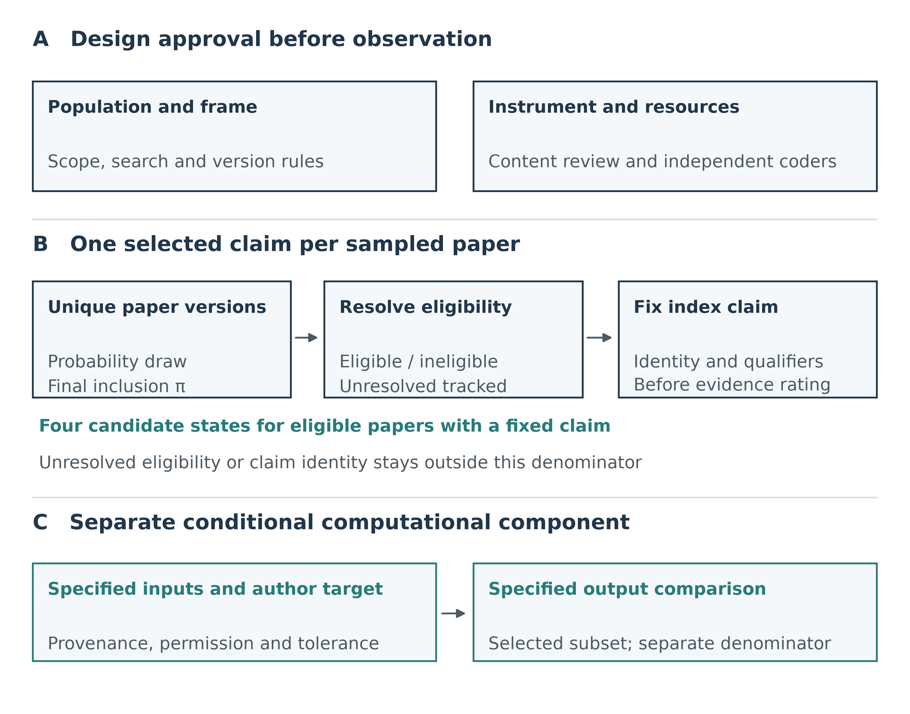

# Claim–evidence alignment in chronic-disease single-cell transcriptomics: a prospective meta-research design

**AUTHOR REVIEW — NOT FOR SUBMISSION. Editorial derivative, 12 October 2026.**

Scope: one rule-selected claim per eligible paper version. The study remains prospective; this document does not approve RP V4 implementation or supply empirical results.

## Abstract

**Background:** Single-cell transcriptomics can resolve disease-associated cellular states and generate hypotheses about communication between cells. Whether the wording of a paper's central claim is supported by its measurements, biological replication and validation must be assessed at the level of that claim. Methodological examples do not establish the frequency of mismatch across a literature population.

**Objective:** To develop a probability-sampled audit of one prespecified index claim per eligible human chronic-disease paper, distinguishing claim–evidence alignment from biological replication and validation independence.

**Proposed methods:** The audit would cover peer-reviewed human non-oncology studies using single-cell or single-nucleus transcriptomics. Independent reviewers would resolve eligibility, select the index claim without using its eventual evidence rating, and link that proposition to public source evidence. Four candidate nominal states are aligned, narrower supported, material mismatch and not evaluable. The analysis would distinguish the distribution among papers with resolved eligibility and a fixed claim from the intended distribution among all genuinely eligible papers. Unresolved eligibility and claim selection would be reported separately, with sensitivity analyses rather than automatic assignment to not evaluable. A conditional computational audit would address a separate, explicitly selected subset.

**Current status and implications:** No formal corpus has been sampled or independently coded. Scope, sampling, content validity and reviewer calibration remain unapproved. This manuscript specifies a design for external review; it does not estimate a mismatch rate or demonstrate the validity of the proposed classification.

**Keywords:** single-cell transcriptomics; meta-research; biological replication; claim–evidence alignment; probability sampling; validation independence

## Introduction

Single-cell transcriptomics provides detailed descriptions of cellular heterogeneity, but a computational pattern, its biological interpretation and a mechanistic conclusion are different inferential steps. Lin and Yu recently organized these steps into an observation–inference–claim framework [1]. Analytical guidance also emphasizes that preprocessing, annotation and downstream analysis depend on the question and measurement modality [2]. These contributions explain why conclusions require calibration. They do not establish how often published claims exceed the evidence available for them.

Biological replication is one claim-relevant dimension. When a conclusion concerns differences between people, the number of cells is not the number of independent participants. Squair and colleagues demonstrated that disregarding biological replicate structure can produce false discoveries in single-cell differential expression [3]. The implication for an audit is to reconstruct the donor–specimen–library–cell hierarchy and the inferential model, rather than infer adequacy from a large cell count. A donor-level model and a cell-level descriptive analysis answer different questions; neither should be judged without identifying the population to which the paper's statement refers.

Communication inference poses a related measurement problem. Ligand–receptor analyses use expression data, prior interaction resources and scoring methods to nominate potential interactions. A systematic comparison showed that methods and resources affect the inferred interaction results [4]. A claim of predicted communication should therefore be assessed against that inferential task. A stronger statement about physical interaction or functional mediation requires evidence addressing those additional propositions. Spatial proximity, protein detection and perturbation are distinct evidence types, and their relevance depends on the exact wording and experimental context.

Auditing terminology alone would miss this relationship between proposition and evidence. Haber and colleagues evaluated causal and associational language in observational health research [5], but that population and instrument cannot supply a mismatch estimate for chronic-disease single-cell studies. Conversely, demanding functional perturbation for every descriptive cell-state claim would impose a standard the authors did not claim to meet. A useful audit must preserve the author's qualifiers and evaluate the original statement before recording any narrower interpretation.

The unresolved question is not whether single-cell analyses have limitations, but how often a defined paper-level claim is supported by the public evidence available for it. We propose a meta-research study that combines probability sampling with source-linked assessment of a single index claim. Its intended contribution is an empirical distribution with an explicit denominator and an auditable measurement process. Search peer review and transparent reporting would support construction of the bibliographic frame, drawing on Peer Review of Electronic Search Strategies (PRESS) and the literature-search reporting extension of the Preferred Reporting Items for Systematic reviews and Meta-Analyses (PRISMA-S) [6,7]. Neither procedure can establish the validity of the claim categories or the statistical target. Figure 1 separates these design requirements from the observations the future study would generate.

**Figure 1. Proposed paper-level audit, with the inferential denominator separated from computational reproduction.** A, scope, frame and measurement rules require independent approval before implementation. B, probability sampling, eligibility resolution and index-claim fixation precede evidence-state coding; the four-state denominator contains confirmed eligible papers with a fixed index claim, including those whose evidence is not evaluable. C, conditional computational reproduction concerns a separately selected subset with bound input identity and does not supply the primary population endpoint. Arrows represent proposed procedural order, not observed relationships. There are no empirical counts or human ratings. The unchanged Stage63 master and its design metadata are retained; they do not establish instrument validity.

## Objectives

The primary objective is to describe the distribution of four candidate claim–evidence states for one index claim per confirmed eligible paper version. The target is the claim selected by a prespecified paper-level rule, not every mechanistic statement in a paper or the proportion of erroneous findings in all single-cell research.

Secondary objectives are to describe biological replication, the statistical unit of inference, validation independence and the availability of claim-relevant public evidence. A separately authorized computational component could examine the reproduction of specified author outputs. It would have its own denominator and would not determine which papers enter the primary audit. Extension from the observable, resolved-paper distribution to all genuinely eligible papers is an additional inferential objective that requires assumptions about unresolved records.

## Proposed methods

### Design status and scope

The methods below are a prospective design submitted for author and external methodological review. The final protocol has not been registered, and formal sampling, calibration and coding have not started. Proposed definitions must be reconciled with independent scope, clinical, information-specialist, statistical and content review before implementation. Editorial clarification in this manuscript does not approve an operational rule.

The provisional publication window is 1 January 2022 through 30 September 2026. The proposed population comprises peer-reviewed original human non-oncology chronic-disease studies using single-cell or single-nucleus transcriptomics. The two candidate claim families are disease-associated cell-type or cell-state claims and cell-resolved inferred intercellular-communication claims. Other modalities or functional experiments may provide relevant evidence for such a claim without creating an additional primary family. Chronicity, mixed human–animal studies, mixed acute–chronic settings and the treatment of preprints and later journal versions require explicit eligibility rules.

### Bibliographic frame and source cutoff

Bibliographic sources, search strategies, publication-version rules and deduplication procedures would be fixed before formal sampling. Search records would be linked to unique paper versions, with retained identifiers and a documented rule for papers represented in multiple sources. The final database list remains undecided. The study's inferential population would be the eligible papers covered by this approved frame; completeness of retrieval cannot be assumed from reproducible search syntax alone.

An independent information specialist would review the primary search using the six retained PRESS domains, while PRISMA-S would guide reporting of sources, queries, limits, execution dates and deduplication [6,7]. Project-specific checks on coverage and frame construction would be distinguished from formal PRESS review. A public-evidence cutoff would specify which article version, supplements, repository releases and dated corrections may inform each rating. Later private correspondence would be identified separately and would not silently alter the public-evidence endpoint.

### Sampling and feasibility assessment

Selection would use a documented probability design with nonzero inclusion probabilities for every unit in the approved frame. The sampling unit would be the unique paper version, not a cell, donor or extracted sentence. Proposed stratification variables, allocation, randomization, replacement rules and the treatment of repeated cohorts across papers require statistical approval before the frame is drawn. The final inclusion probability must correspond to the actual analytic selection process.

A proposed 50–80-record feasibility pilot would assess eligibility yield, retrieval, screening time and coding workload. It is not an observed pilot, and 160–200 completed papers is only a planning range. Supplementary Figure S1 illustrates how assumed eligibility and completion rates affect screening burden. Its precision curve is an approximate binary planning calculation, not the precision of the proposed four-category endpoint. Feasibility decisions require measured workload and confirmed reviewer capacity.

If pilot findings change main-sample size or allocation, the joint design must account for that adaptation. Keeping pilot papers out of the main analysis does not by itself justify treating the resulting sample size as fixed. If pilot papers are included, their inclusion through either route must also be considered. Conditional probabilities given the realized pilot and unconditional inclusion probabilities are different quantities. A statistical analysis plan would specify which target, estimator and variance method each design supports before claim-state outcomes are examined.

### Eligibility and index-claim selection

Eligibility would be recorded as confirmed eligible, confirmed ineligible or unresolved, with source locators and reasons. Reviewers would also distinguish an eligible paper whose claim has not yet been fixed from a paper confirmed to contain no qualifying claim under the approved scope. Failure to finish selection is a process state, not evidence that the paper is ineligible.

For an eligible paper, the index claim would be selected independently of its eventual evidence rating. The original sentence, location and paper version would be retained. Selection would identify one atomic proposition, including its subject, claimed relationship, direction, population, context and qualifiers. Splitting a compound sentence must not remove a qualification or select the proposition whose evidence appears weakest.

The rule for papers containing both claim families remains unresolved. A deterministic hierarchy linked to the paper's stated main objective and a probability-based claim selection are different possible designs. They induce different estimands and must not be interchanged after inspecting evidence. The same applies to ties within a family. Two reviewers would record their proposed claim identities before evidence-state agreement is calculated. Disagreement about which proposition to rate must first be resolved and logged; agreement on ratings of different propositions is not interpretable as agreement on the index claim.

### Biological replication and validation identity

Extraction would reconstruct, where public sources permit, participants, specimens, repeated biopsies, aliquots, libraries, regions and cells or nuclei. Reported biological and technical sample sizes would remain distinct. The audit would record the actual replication level, model treatment of repeated observations, relevant covariates and the population of generalization. It would not classify all use of cells as statistical units as inappropriate; the question is whether the analysis and uncertainty address the level claimed.

Validation would be described by what it tests and by its sample identity. A different assay on the same participants may supply orthogonal measurement support without independent biological replication. A new library or tissue section is not automatically a new donor. External cohorts would require traceable participant and dataset identity, including known overlap. Where overlap cannot be resolved, independence would be marked unknown. These factual fields would support interpretation of the index claim, rather than being collapsed into a universal quality score.

### Candidate claim–evidence states

The four labels are candidate nominal states, not an ordered ladder or validated scale. Table 1 describes their intended distinctions. An aligned rating would concern support for the stated proposition within its qualifications. Narrower supported would retain the original statement while identifying the precise, weaker proposition supported by the available evidence. Material mismatch would require an identifiable, consequential incompatibility or inferential overextension. Not evaluable would indicate insufficient accessible or interpretable evidence for a fixed claim in a confirmed eligible paper.

The distinction between narrower supported and material mismatch requires explicit content review. Both could apply to an overextended statement unless the manual fixes precedence, materiality and the evidence required for each decision. Reviewers would not resolve that ambiguity by intuition during main coding. Missing evidence alone would not establish contradiction, and an aligned rating would not certify universal biological truth. The classification concerns the claim–public-evidence relationship at the specified cutoff.

**Table 1. Candidate nominal states for independent content review; not a validated scoring scale.**

| Candidate state | Relationship being judged | Required boundary |
| --- | --- | --- |
| Aligned | Accessible evidence supports the original proposition within its stated context and qualifiers | Not certification of universal biological truth |
| Narrower supported | An explicitly specified weaker proposition is supported, but the original claim exceeds that support | Original and narrower propositions retained; precedence versus material mismatch unresolved |
| Material mismatch | Identifiable, consequential incompatibility or inferential overextension relative to the original proposition | Not inferred from missing files or a nonsignificant exploratory analysis alone |
| Not evaluable | Evidence is insufficiently accessible or interpretable for a fixed claim in a confirmed eligible paper | Inside the four-state denominator; not interchangeable with unknown eligibility or an unfixed claim |

These candidate definitions cannot be operationalized until independent content review resolves materiality, precedence and boundary cases.

### Independent coding and adjudication

Two independent human reviewers would complete the approved instrument before discussing ratings. Their qualifications, conflicts, exposure to the development material and capacity would be documented. Calibration would use material disjoint from the formal sample unless a separately justified design specifies otherwise. Claim-identity agreement and four-state agreement would be measured separately.

Raw agreement, the full contingency table and category-specific disagreements would be reported before adjudication. A chance-adjusted measure appropriate to nominal categories would be selected and justified in advance; no ordinal weighting is implied by the four labels. The agreement threshold and uncertainty calculation remain unapproved. Adjudication would follow preservation of both independent forms and the pre-adjudication results. It would produce a resolved dataset without replacing the original ratings or converting adjudicated consensus into evidence of independent agreement.

### Estimands and unresolved records

Let F denote the approved finite bibliographic frame. For paper i, Iᵢ indicates sampling, πᵢ is its justified final inclusion probability and wᵢ = 1/πᵢ. Eᵢ denotes true eligibility, Rᵢ whether eligibility has been resolved and Cᵢ whether the index claim has been fixed under the approved rule. Define Aᵢ = RᵢEᵢCᵢ. For Aᵢ = 1, Yᵢ is the observed evidence category, including not evaluable. The proposed ratio for category k is:

$$
\widehat p_k^{\mathrm{resolved}}=
\frac{\sum_{i\in F}I_iw_iA_i\mathbf{1}(Y_i=k)}
{\sum_{i\in F}I_iw_iA_i},\qquad A_i=R_iE_iC_i.
$$

The expression is defined only when the denominator is positive; it is a proposed weighted ratio, not an observed estimate.

This estimates a distribution conditional on eligibility resolution and claim fixation under a defensible sampling design. A ratio estimator is not generally exactly design-unbiased. Known sampling probabilities do not correct selective eligibility resolution or claim-selection completion. Even if the intended target is all genuinely eligible papers, the complete-record ratio alone does not identify that target.

Not evaluable remains inside the four-state denominator when eligibility is confirmed and the claim is fixed. Unresolved eligibility and unresolved claim identity remain outside that denominator and must be reported in the frame flow, with their weighted mass when justified. Treating every unresolved record as not evaluable would change the meaning of the endpoint. Reporting only the three evaluable categories would instead condition on evidence availability and must not replace the four-state distribution without an explicit alternative estimand.

Supplementary Methods S2 specifies candidate weighted sensitivity envelopes that impose no distributional assumption on the categories of unresolved records. These envelopes describe ambiguity in assigning unresolved mass; they are not confidence intervals or a complete design-based population analysis. Any missingness model, adjustment, variance estimator, finite-population correction, cohort dependence or simultaneous four-category inference must be justified in the final statistical plan. No numerical empirical estimate is available at present.

### Conditional computational component

Computational reproduction would be a distinct component for an explicitly selected and authorized subset. Its target would identify the author output, expression representation, participant and cell mapping, annotation, software environment, database version and comparison tolerance. Reproducing a historical author calculation and estimating a new donor-aware contrast are different tasks. Agreement between two implementation variants would not constitute independent biological validation.

Every attempted computation would have an input-identity and execution record. Inaccessible or unbound historical inputs would limit what can be concluded about reproduction, rather than establish failure of the biological claim. Success or failure in this selected subset would not be extrapolated to the primary paper population. At present, no computational result supports a claim about the reproducibility of that population.

### Records and disclosure

Source locators, extraction versions, selection probabilities and adjudication history would accompany the analysis dataset. Public dissemination would separate redistributable code and derived audit fields from restricted source material, reviewer identities and private correspondence. Authorship, funding, competing interests and any ethics or consent determinations would require explicit confirmation. No approval, exemption or consent is inferred from the absence of new patient recruitment.

## Current evidence and conditions for implementation

No formal probability sample, independent ratings or primary claim-state distribution has been produced. The figures in this manuscript and supplement display the proposed design and hypothetical planning calculations only. Completed search yields, observed workload, reviewer agreement, biological-unit summaries and weighted category estimates will require an authorized empirical study. Those results cannot be filled from development cases or software integrity checks. Historical disease-axis analyses and frozen synthetic classifier failures are maintained as a separate development record: they may motivate safeguards, but were neither probability-sampled papers nor independent ratings under this instrument. They are therefore not included as primary Results figures in this manuscript.

## Discussion

### Contribution: a measured distribution rather than another framework

The proposed study addresses an empirical question left open by conceptual guidance. The observation–inference–claim framework makes interpretive transitions explicit [1], while analytical best practices identify dependencies between preprocessing, measurement and downstream analysis [2]. Our proposed contribution would be to measure a defined paper-level distribution using a documented selection process and source-linked ratings. Until such data exist, the design cannot support a statement that mismatch is common, increasing or concentrated in a particular disease or method.

### Matching the inferential claim to the biological unit and validation

The measurement strategy would preserve differences between evidence types. Biological replicate-aware differential expression addresses variation between experimental units [3]. Agreement among communication tools, by contrast, concerns results of methods and resources used for inference [4]. Neither a larger cell count nor several agreeing computational tools automatically supplies independent participants or a direct functional test. Recording these dimensions separately would make the reason for a rating inspectable without presuming that every claim demands the same validation.

### Separating unavailable evidence from a consequential mismatch

A second interpretive distinction concerns unavailable evidence. Public material may be inadequate to judge a proposition even when the underlying work was sound. Not evaluable therefore describes an audit limitation, not a failed biological experiment. A confirmed incompatibility requires a different evidential basis. Content experts must test these distinctions using boundary cases, including descriptive claims with adequate replication, mechanistic wording with only predicted interactions, and apparently external validation whose participant identity is unclear. These examples are proposed tests of the instrument, not ratings of actual papers.

### Generalization depends on the frame and the observable denominator

Probability sampling would support generalization only to the specified frame under the approved design. Selective retrieval, unresolved eligibility and failure to fix a claim can alter the observable denominator. The distinction between the resolved-paper distribution and the all-eligible target should remain visible in the final title, abstract and interpretation. Sensitivity envelopes may expose the consequences of unresolved mass, but they cannot compensate for an undefined claim-selection rule or an untraceable probability design.

### Advance, narrow or stop before observing formal outcomes

Feasibility and content validity should determine whether the proposed study proceeds at its current breadth. Independent review must establish an operable claim-selection rule and a defensible classification; a separately authorized pilot must measure yield and person-hours. If the four-state instrument cannot be used reliably, a prospectively narrower audit of biological units and validation independence may be more informative. That decision must precede formal sampling and access to primary outcomes. A broader manuscript would not become stronger merely by accumulating more unresolved ratings.

## Limitations

The protocol is provisional. Its disease scope, frame coverage, publication-version rules, evidence cutoff, sampling design, classification precedence and calibration criteria remain unsettled. A paper-level index claim simplifies extraction but excludes other statements, and its selection rule may affect comparisons between claim families. Public evidence may omit participant identifiers or details needed to establish independence. Published papers may also reuse cohorts, making paper independence a statistical assumption that requires examination.

The four-state instrument has no completed content-validity or independent reliability evidence. Approximate planning calculations do not establish the eventual sample size or precision. The conditional computational component is selected and cannot supply a population reproducibility rate. These limitations define the work required before an empirical article can be completed; they are not findings about the quality of the target literature.

## Conclusion

A paper-level audit of single-cell claims requires a fixed proposition, traceable biological units and an explicit inferential denominator. The proposed design separates unavailable evidence from material mismatch and separates computational reproduction from biological validation. Its next scientific test is independent approval of the scope, sampling and instrument, followed by an authorized feasibility pilot and calibration. The present manuscript remains a prospective design without empirical findings.

## Declarations for author completion

Author identities, contributions, funding, competing interests, ethics determination, registration and target-journal requirements remain unconfirmed. No declaration of approval, exemption, consent, registration or journal compliance is made. A data-availability statement for the eventual study must distinguish public derived audit fields from copyrighted articles, restricted participant mappings and private reviewer records. This author-review version is not an empirical submission package.

## Abbreviations

PRESS, Peer Review of Electronic Search Strategies; PRISMA-S, Preferred Reporting Items for Systematic reviews and Meta-Analyses literature-search extension.

## References

1. Lin S, Yu G. From Cluster to Claim: Calibrating Interpretation in Single-Cell Transcriptomics. Advanced Genetics. 2026;7:e70045. doi:10.1002/ggn2.70045.

2. Heumos L, Schaar AC, Lance C, et al. Best practices for single-cell analysis across modalities. Nature Reviews Genetics. 2023;24:550–572. doi:10.1038/s41576-023-00586-w.

3. Squair JW, Gautier M, Kathe C, et al. Confronting false discoveries in single-cell differential expression. Nature Communications. 2021;12:5692. doi:10.1038/s41467-021-25960-2.

4. Dimitrov D, Türei D, Garrido-Rodriguez M, et al. Comparison of methods and resources for cell-cell communication inference from single-cell RNA-Seq data. Nature Communications. 2022;13:3224. doi:10.1038/s41467-022-30755-0.

5. Haber NA, Wieten SE, Rohrer JM, et al. Causal and Associational Language in Observational Health Research: A Systematic Evaluation. American Journal of Epidemiology. 2022;191:2084–2097. doi:10.1093/aje/kwac137.

6. McGowan J, Sampson M, Salzwedel DM, et al. PRESS Peer Review of Electronic Search Strategies: 2015 Guideline Statement. Journal of Clinical Epidemiology. 2016;75:40–46. doi:10.1016/j.jclinepi.2016.01.021.

7. Rethlefsen ML, Kirtley S, Waffenschmidt S, et al. PRISMA-S: an extension to the PRISMA Statement for Reporting Literature Searches in Systematic Reviews. Systematic Reviews. 2021;10:39. doi:10.1186/s13643-020-01542-z.
