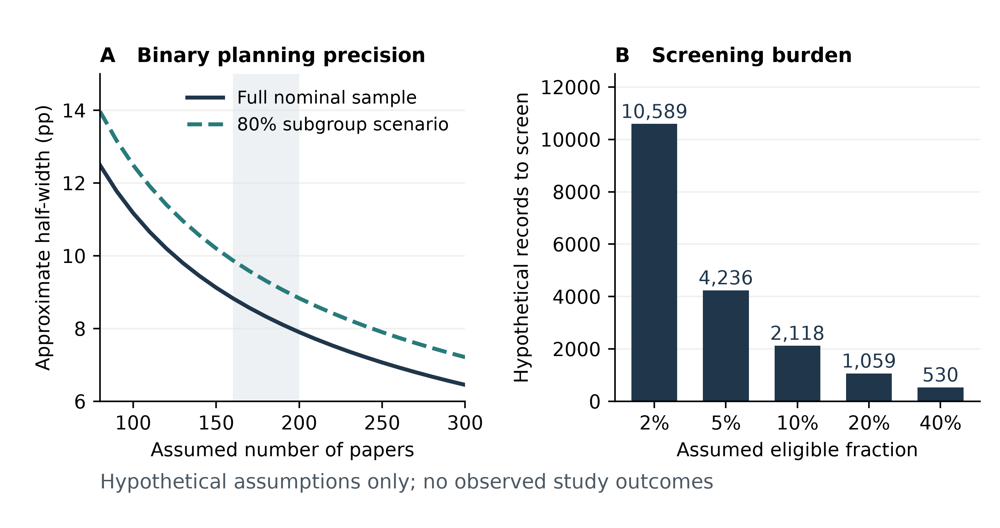

# Supplementary design and planning material

This material accompanies the prospective manuscript on claim–evidence alignment. The definitions below clarify design issues for review. They do not amend the operative research protocol, constitute independent approval or supply observed study results.

## S1 Hypothetical precision and screening burden

Supplementary Figure S1 retains the numerical assumptions used in the supplied planning table. Panel A uses a normal-approximation half-width for a binary proportion with assumed p = 0.50, a critical value of 1.96 and a design effect of 1.30. The second curve assumes that 80% of the nominal sample belongs to an illustrative subgroup. Neither curve is a confidence interval for the proposed four-state endpoint.

$$h(n,f)=100\times1.96\sqrt{\frac{1.30\times0.50\times0.50}{nf}}.$$

This is a binary, normal-approximation planning expression under assumed design effect, not an empirical confidence interval.

Here h is the half-width in percentage points, n is the assumed nominal number of papers, and f is either 1.0 or 0.8. The calculation omits finite-population correction, actual stratum weights, adaptation, nonresponse covariance and joint category inference. The highlighted n = 160–200 range is a planning interval, not a selected sample or an approved sample size.

Panel B calculates the initial screening count as ceil[180/(r × 0.85)] at assumed eligibility rates r of 2%, 5%, 10%, 20% and 40%. It assumes 85% completion after eligibility. The resulting 10,589, 4,236, 2,118, 1,059 and 530 records are hypothetical workloads. Actual yield, completion, review time and design effect have not been measured. The 51 source-data rows are preserved with their assumption flags and checked against the supplied table.

**Supplementary Figure S1. Assumption-based planning, not observed study performance.** A, binary-proportion half-width under the assumptions stated above; the second curve uses an illustrative 80% subgroup and the shaded 160–200 range remains unapproved. B, screening burden for 180 completed papers, at assumed eligibility rates and 85% subsequent completion. No observed eligibility rate, reviewer work time or four-category precision is shown. The unchanged Stage63 master and all 51 assumption-flagged source rows are preserved.

## S2 Candidate estimands and sensitivity envelopes

The distinction between true eligibility E, resolved eligibility R and fixed index claim C is essential. The main manuscript defines A = REC and reports a proposed ratio among A = 1 papers. A fixed claim with unavailable public evidence can receive not evaluable. Unknown eligibility and a claim that has not been fixed cannot be assigned that category merely to complete a row.

Let D be the justified weighted mass of papers with A = 1, and Nₖ the mass assigned to category k. Let V be the weighted mass of confirmed eligible papers whose index claim is unresolved. Let U be the mass with unresolved eligibility. The proposed complete-record proportion is Nₖ/D when D > 0. Without additional information, V must belong to the eligible denominator but can be assigned to any category; U can be ineligible or eligible in any category. Under those assumptions, marginal weighted envelopes are:

$$L_k=\frac{N_k}{D+V+U},\qquad H_k=\frac{N_k+V+U}{D+V+U}.$$

Here the weighted masses and eligibility interpretation are assumed fixed for this allocation exercise. The labels L and H denote marginal ambiguity bounds, not confidence limits.

For the lower endpoint, all unresolved mass is eligible and outside category k. For the upper endpoint, all unresolved mass is eligible and inside category k. These are sharp marginal envelopes for the stated allocation problem with fixed positive weights and a positive observed denominator. The choices attaining different category endpoints generally cannot all occur together; each feasible joint composition must sum to one. The envelope is not a confidence interval, does not include sampling uncertainty and does not make a finite-frame population estimator design-valid by itself.

If D = 0, the complete-record proportion is undefined. If no eligible mass is known and the entire eligible population could be empty, a proportion requires conditioning on a nonempty eligible population before stating any bounds. A record that cannot contain a qualifying claim under the approved selection rule is not interchangeable with an unfinished selection. Constraints learned from source evidence can tighten these envelopes, but must be documented rather than inferred from outcome direction.

Missing-at-random corrections or response-propensity weights would require additional assumptions beyond known sampling probabilities. The eventual analysis plan must specify the population, observability mechanism, estimator, variance, clustering and handling of adaptive sample selection. The formulas here are review candidates, not a registered analysis plan.

## S3 Index-claim selection and classification decisions

The manuscript retains one selected proposition per paper. It does not choose a family hierarchy on behalf of the independent experts. Review must resolve whether cell-state and communication claims are selected by a deterministic hierarchy, by a rule tied to the paper's main objective or through a probability-based second stage. If claim selection is random, the intended paper-level or claim-level estimand and conditional selection probability must be specified. A paper-sampling weight alone cannot be assumed to estimate all claims in the literature.

The approved manual must also resolve materiality and precedence between narrower supported and material mismatch. A purely hypothetical example is an author statement that a cell population mediates disease, supported only by a replicated association. One reviewer might identify a supported association; another might identify overextension of mediation. Both observations can be true. They become mutually exclusive endpoint categories only when an approved decision rule assigns the case reproducibly. This example is not a rating of a real article.

Before main coding, content review should test boundary cases and confirm the exact evidence needed for each category. Independent claim selection, evidence ratings and adjudication must retain separate records. A high agreement statistic cannot establish that the chosen claim is representative or that the construct is scientifically valid.

## S4 Prospective extraction fields

Supplementary Table S1 defines the minimum provenance dimensions that the future instrument would need to record. Field names are an editorial specification for review, not a completed dataset or validated coding manual.

**Supplementary Table S1. Proposed extraction domains and why they must remain distinguishable.**

| Domain | Minimum candidate fields | Inferential purpose |
| --- | --- | --- |
| Paper and version | Persistent identifier, version, correction history, source locator, public-evidence cutoff | Reconstruct the exact rated evidence |
| Sampling | Frame identifier, stratum, pilot/main route, final inclusion probability and derivation | Define the paper-level sampling denominator |
| Eligibility | Eligible/ineligible/unresolved, reason, reviewer, supporting location | Keep unknown eligibility outside the four-state endpoint |
| Index claim | Verbatim sentence, atomic proposition, qualifiers, family, selection rule, tie resolution, freeze time | Prevent evidence-driven claim selection |
| Biological units | Donors, specimens, repeated biopsies, libraries, cells/nuclei, overlap and identity certainty | Distinguish independent biological replication from technical expansion |
| Statistical inference | Unit of analysis, repeated-measure model, covariates, estimand, uncertainty, test family | Check whether analysis supports the level of the stated claim |
| Validation | Assay type, inferential task, participant overlap, external cohort identity, unknown independence | Separate orthogonal evidence from independent replication |
| Evidence rating | Candidate state, source-linked rationale, narrower proposition if relevant, uncertainty | Preserve what supports the decision rather than only its label |
| Independent review | Reviewer role, conflicts and exposure, original form/version, claim-identity and rating agreement | Measure reliability before adjudication |
| Adjudication | Date, issue, decision, source, unchanged originals | Distinguish resolved consensus from independent agreement |
| Conditional computation | Author output, input representation, mapping, environment/database versions, run binding, tolerance | Limit interpretation to an explicitly selected reproduction task |

This is a review specification, not an approved database schema or a completed extraction form.

## S5 Conditional computational identity

A computational comparison must specify the output being reproduced and whether the task is historical reconstruction, implementation verification or a new statistical analysis. Exact expression representation, sample and annotation mappings, software and resource versions, author-run binding and tolerances would be documented before execution. A new donor-aware contrast does not retrospectively reproduce an author result with a different estimand.

A subset with accessible inputs is selected on accessibility and feasibility. Its results would therefore require a separate denominator and a limited interpretation. Restricted files, private correspondence and participant-identifying mappings must remain outside the public package unless specific authority permits release.

## S6 Reproducible planning material

The original Stage63 generation record is preserved. This Stage67 derivative copies Figure 1 and Supplementary Figure S1 without changing their bytes; its builder creates only separate historical display exhibits from frozen summary tables. No disease model, author computation, formal corpus search or human rating is executed by that builder. Figure 1 is a prospective schematic with no observed counts. All numeric planning rows carry ASSUMPTION_NOT_OBSERVED. The package contains no completed human ratings, patient-level analysis or population mismatch estimates.
